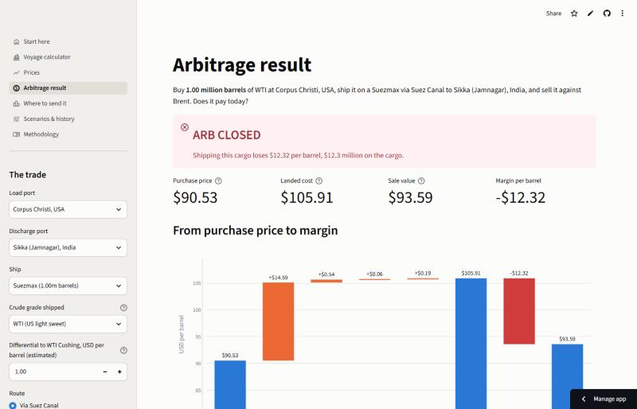
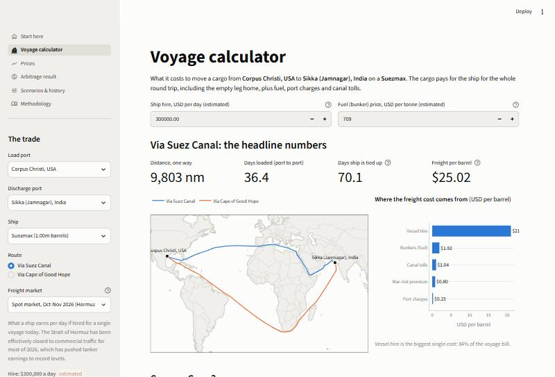
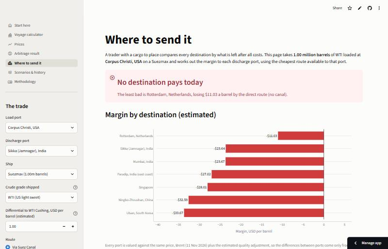
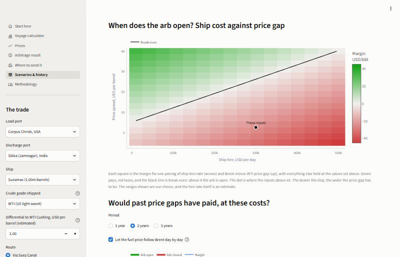

# Physical Crude Arbitrage & Voyage Engine

[](https://github.com/blasph3mous11-ui/arb-engine/actions/workflows/tests.yml)

A dashboard that answers the question a physical oil trader asks every day:

> **If I buy a cargo of crude at port A and ship it to port B, do I make money today, and what drives the answer?**

The starting case is 1 million barrels of US Gulf Coast crude shipped to the west coast of India
on a Suezmax tanker, via the Suez Canal or around the Cape of Good Hope.

**Live dashboard:** https://crude-arb-engine.streamlit.app  
Code: https://github.com/blasph3mous11-ui/arb-engine

**What you can choose**

| | Options |
|---|---|
| Load port | US Gulf Coast: Corpus Christi, Houston, LOOP (offshore Louisiana), Beaumont / Nederland. North Sea: Hound Point (UK, Forties), Mongstad (Norway, Johan Sverdrup) |
| Discharge port | India: Sikka, Mumbai, Paradip. Europe: Rotterdam. East Asia: Singapore, Ningbo-Zhoushan, Ulsan |
| Ship | Panamax (0.5m bbl), Aframax (0.75m), Suezmax (1m), modern eco Suezmax (1m), VLCC (2m) |
| Route | Worked out for each voyage: Suez or Cape where the shortest path passes Suez; one direct route across the Atlantic to Europe. A VLCC, too deep for Suez when full, goes via the Cape. |
| Crude grade | US Gulf: WTI, WTI Midland (light sweet export grade), Mars (medium sour). North Sea: Forties (light sweet), Johan Sverdrup (medium sour). Each with an editable differential to its benchmark |
| Freight market | Today's spot market, a one-year time charter, or a calm-market reference |
| Freight basis | The daily hire rate from the freight market, or a broker's quote you type in (Worldscale points and flat rate, or a lump sum), with the shipowner's implied daily earnings (TCE) |
| Ship speed | The ship's usual speeds, the cheapest speeds for today's hire, fuel, cargo interest and carbon costs, or your own (10 to 15 knots) |

US Gulf grades (WTI, WTI Midland, Mars) are priced off WTI Cushing, North Sea grades (Forties, Johan Sverdrup) off Brent, each plus an estimated differential. The Panama Canal is not offered as a route.



## What it does

| Page | What you see |
|---|---|
| **Voyage calculator** | Sea distance, voyage days and freight cost per barrel, broken down into ship hire, fuel, port charges, canal tolls and war-risk premium. Suez and Cape side by side, with a route map, and a chart of what each loaded speed costs, showing the cheapest. |
| **Prices** | Daily Brent and WTI history (US EIA), monthly Dubai (World Bank), and the spread between origin and destination benchmarks (monthly averages when Dubai is chosen). |
| **Arbitrage result** | The full cost stack from purchase price to landed cost to margin as a waterfall, with an **ARB OPEN** or **ARB CLOSED** verdict, every line explained, and a one-click spreadsheet recap of the trade with every line marked published, estimated, typed in or calculated. |
| **Where to send it** | The same cargo costed to every discharge port by its better route, ranked by margin: the netback view a trader uses to place a cargo. |
| **Scenarios & history** | Sliders for the main drivers, a tornado chart of what moves the margin most, the break-even spread, a grid of ship cost against price gap showing where the arb opens, and the model re-run over past prices. |
| **Methodology** | Every assumption with its value, source, date checked and whether it is an estimate, plus what the model leaves out. |





## What is real and what is estimated

This project uses **public benchmark prices and documented estimates**. It does **not** use real
traded freight rates or physical price premiums, which are sold by subscription (Baltic Exchange,
Platts, Argus).

- **Published data:** Brent and WTI daily spot prices, Dubai monthly average, the Suez Canal
  Authority toll tariff and surcharges, SOFR, ship sizes, the Aframax and VLCC speeds and fuel use
  (Platts freight guide, Baltic Exchange), crude grade qualities from assays (WTI
  Midland's taken from its specification range and flagged as an estimate) and the EU carbon
  scheme's rules.
- **Documented estimates:** the daily ship hire rate (our own figure, or a published broker or
  press figure for another route or contract used as a proxy), bunker (fuel) price, the Panamax
  and Suezmax speeds and fuel consumption (not found in the guides, or scaled from their figures),
  fuel use at other speeds (the IMO's cube-of-speed rule of thumb) and the allowed speed range,
  canal tonnage, port
  costs and port days, the bank margin, insurance and war-risk cover, transit loss, quality
  adjustment, each grade's differential to WTI or Brent, the dollar-per-SDR rate used for canal
  tolls, the reverse-lightering cost, the carbon allowance price and dollar-euro rate, and broker
  commissions.
  Each is flagged `estimate: true` in the assumption files and labelled "estimated" on screen.
- **No forecasting.** The tool explains today's economics. It does not predict prices or
  generate trading signals.

Every number lives in a YAML file under [`data/assumptions/`](data/assumptions) and is listed in
[`docs/ASSUMPTIONS.md`](docs/ASSUMPTIONS.md). Nothing is hard-coded in the calculations.

## Run it

You need Python 3.10 or newer. On Windows, double-click `run_dashboard.bat`: it installs the
packages on first use and opens the dashboard. Or, in a terminal, from this folder:

```
python -m venv .venv
.venv\Scripts\activate          (Windows)      source .venv/bin/activate   (Mac / Linux)
pip install -r requirements.txt
streamlit run app/main.py
```

The dashboard opens in your browser at http://localhost:8501. Prices download automatically
(no account or key needed) and are saved in `data/cache/` so the dashboard also works offline.

Run the tests with:

```
pytest
```

They also run automatically on GitHub after every upload; the badge at the top shows the result.

## How it is built

```
app/                  Streamlit dashboard, one file per page (display only)
engine/
  voyage.py           distances, voyage days, voyage costs, Suez toll
  prices.py           price downloads and caching
  costs.py            financing, insurance, transit loss, quality, demurrage
  arbitrage.py        combines everything into the margin
  scenarios.py        tornado, break-even, freight-versus-spread grid, historical re-run
  ranking.py          the same cargo costed to every discharge port
  recap.py            the downloadable line-by-line trade recap
  units.py            barrels, tonnes, knots: every conversion in one place
  assumptions.py      reads the YAML assumption files
data/assumptions/     every assumption, with source and date checked
data/seed/            small price snapshot used only if downloads fail on first run
tests/                each calculation checked against a sum worked by hand
docs/                 glossary, assumptions, case study, interview notes
.github/workflows/    runs the tests on GitHub after every upload
```

All calculation logic is in `engine/` with no dashboard code in it, so it is tested on its own.

## Read more

- [Case study: Suez or Cape?](docs/CASE_STUDY.md) - what the Red Sea diversions did to delivered cost.
- [Glossary](docs/GLOSSARY.md) - the trading and shipping terms in plain language.
- [Putting it online](docs/DEPLOY.md) - GitHub and Streamlit Community Cloud, step by step.
- [Interview notes](docs/INTERVIEW_NOTES.md) - a two-minute walkthrough and honest answers on the model's weaknesses.

## Data sources

US Energy Information Administration (Brent, WTI); World Bank Commodity Price Data (Dubai);
Suez Canal Authority Circular 7/2023 (tolls); Federal Reserve Bank of New York (SOFR);
S&P Global Platts freight specifications guide and Baltic Exchange (ship parameters, as reported
in search extracts and treated as estimates until confirmed); Fearnleys weekly report and press
reports (hire rates, used as proxies and treated as estimates); `searoute` (sea distances).
